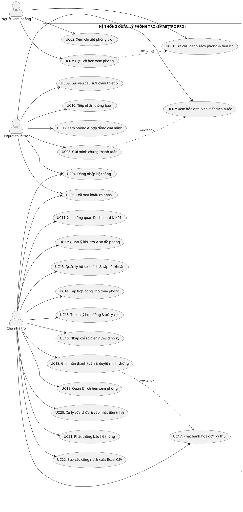
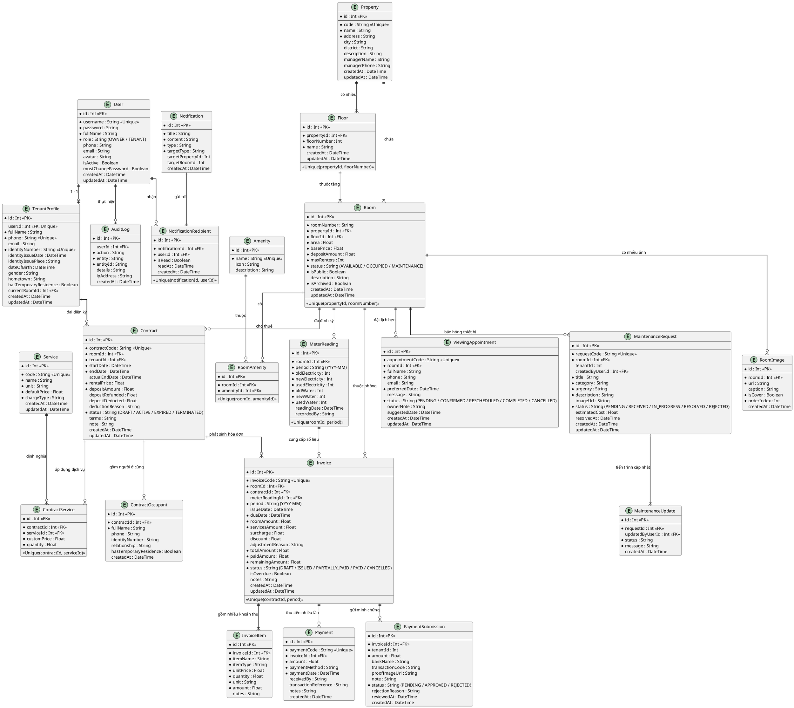
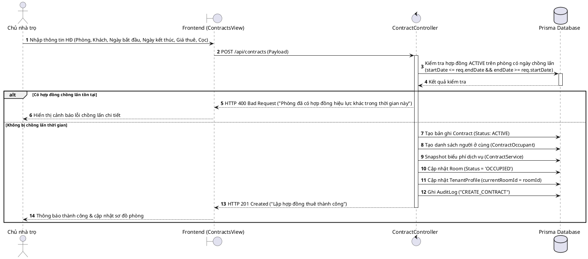
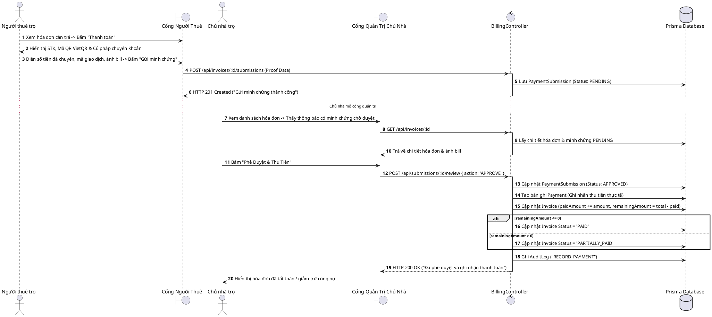
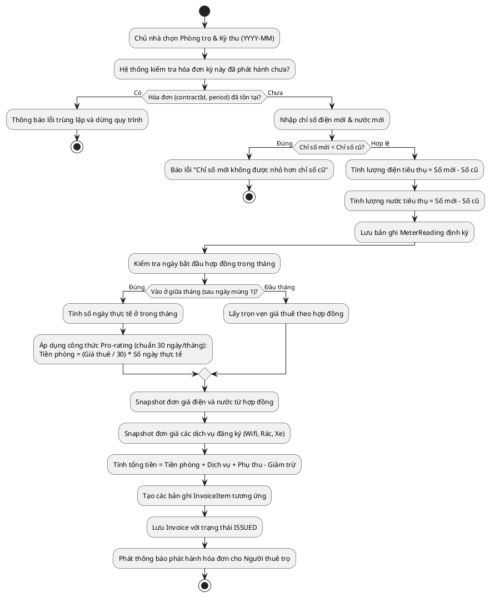

# TÀI LIỆU PHÂN TÍCH NGHIỆP VỤ, KIẾN TRÚC PHẦN MỀM & MÔ HÌNH HÓA UML
## HỆ THỐNG QUẢN LÝ PHÒNG TRỌ & CĂN HỘ DỊCH VỤ (SMARTTRO PRO)
**Đồ án tốt nghiệp / Báo cáo Chuyên ngành Công nghệ Thông tin & Kỹ thuật Phần mềm**

---

## 1. TỔNG QUAN DỰ ÁN

### 1.1. Mô tả bài toán
Tại các đô thị lớn như Hà Nội và TP. Hồ Chí Minh, nhu cầu thuê nhà trọ, căn hộ mini và studio là cực kỳ lớn. Tuy nhiên, phần lớn các chủ nhà trọ hiện nay vẫn quản lý bằng các phương thức truyền thống: ghi chép sổ tay, nhắn tin rời rạc qua Zalo hoặc sử dụng các bảng tính Excel đơn giản. Phương thức này bộc lộ nhiều hạn chế nghiêm trọng:
1. **Sai lệch chỉ số đồng hồ điện nước**: Dễ nhầm lẫn chỉ số cũ - mới, dẫn đến khiếu nại và mất lòng tin giữa người thuê và chủ nhà.
2. **Thất thoát tài chính và khó kiểm soát công nợ**: Không có cơ chế theo dõi đa thanh toán, không phân biệt rạch ròi giữa số tiền phát hành trên hóa đơn và số tiền thực thu về tài khoản.
3. **Trùng lấn hợp đồng và quản lý người ở cùng lỏng lẻo**: Thiếu cơ chế kiểm soát tự động tình trạng phòng, dẫn đến xếp trùng phòng hoặc vi phạm quy định khai báo tạm trú cho công an khu vực.
4. **Trải nghiệm khách tìm phòng lạc hậu**: Người có nhu cầu tìm phòng không có kênh xem trước hình ảnh, bảng giá dịch vụ minh bạch hoặc đặt lịch hẹn xem phòng một cách chuyên nghiệp.

### 1.2. Mục tiêu dự án
Xây dựng một hệ thống phần mềm Web hoàn chỉnh, trực quan và bảo mật cao, số hóa toàn diện quy trình vận hành nhà trọ:
- Cung cấp **Website công khai** giúp khách xem phòng, lọc tiện ích và đặt lịch hẹn xem phòng trực tuyến.
- Cung cấp **Cổng quản trị Chủ nhà trọ (Owner Portal)** quản lý tập trung từ phòng trọ, khách thuê, hợp đồng, dịch vụ, chỉ số điện nước, hóa đơn, thu tiền, duyệt minh chứng thanh toán đến báo cáo tài chính.
- Cung cấp **Cổng người thuê trọ (Tenant Portal)** tối ưu trên thiết bị di động, giúp người thuê tra cứu hóa đơn, theo dõi điện nước, gửi minh chứng chuyển khoản và phản ánh sự cố hư hỏng.

### 1.3. Xác định Actor — Mục 1.3.1 (Văn phong báo cáo học thuật)
Trong phạm vi nghiên cứu và triển khai của đề tài, hệ thống xác định **đúng ba tác nhân nghiệp vụ chính (Actors)**, không bổ sung tác nhân quản trị kỹ thuật (Admin) độc lập nhằm phản ánh sát thực tế quy mô quản lý nhà trọ:

```
+-----------------------------------------------------------------------------------+
|                            BA TÁC NHÂN NGHIỆP VỤ CHÍNH                            |
+--------------------------+----------------------------+---------------------------+
| 1. CHỦ NHÀ TRỌ (OWNER)   | 2. NGƯỜI THUÊ TRỌ (TENANT) | 3. NGƯỜI XEM PHÒNG (GUEST)|
+--------------------------+----------------------------+---------------------------+
| • Sở hữu & quản lý toàn  | • Cá nhân đã ký hợp đồng   | • Khách vãng lai tìm phòng|
|   bộ cơ sở trọ           | • Được cấp tài khoản       | • Không cần tài khoản     |
| • Quản lý phòng, hợp     | • Chỉ xem dữ liệu phòng    | • Xem thông tin công khai |
|   đồng, hóa đơn, thu     |   của chính mình           | • Đặt lịch hẹn xem phòng  |
|   tiền, báo cáo & duyệt  | • Gửi minh chứng thanh     | • Không được xem dữ liệu  |
|   minh chứng             |   toán & báo hỏng thiết bị |   nội bộ hay tài chính    |
+--------------------------+----------------------------+---------------------------+
```

#### 1.3.1.1. Chủ nhà trọ (Vai trò hệ thống: `OWNER`)
Là chủ sở hữu hoặc người chịu trách nhiệm cao nhất về hoạt động kinh doanh của khu trọ. Đây là tác nhân có thẩm quyền quản trị cao nhất trong hệ thống, sở hữu các quyền hạn:
- Quản lý danh mục khu trọ (Property), tầng (Floor), phòng (Room), tiện ích và hình ảnh.
- Quản lý hồ sơ người thuê và cấp/khóa/mở khóa/đặt lại mật khẩu tài khoản người thuê.
- Lập hợp đồng cho thuê phòng (ràng buộc chống trùng lấn thời gian), gia hạn và thanh lý hợp đồng (đối soát tiền cọc, khấu trừ chi phí hư hại).
- Cấu hình bảng giá dịch vụ; nhập chỉ số điện nước định kỳ (ràng buộc chỉ số mới $\ge$ chỉ số cũ).
- Lập hóa đơn kỳ thu (chống lập trùng lặp, snapshot đơn giá), thu tiền nhiều lần, duyệt minh chứng chuyển khoản của khách.
- Tiếp nhận và xử lý lịch hẹn xem phòng; điều phối sửa chữa và phát thông báo hệ thống.
- Xem báo cáo kinh doanh, tỷ lệ lấp đầy, đối chiếu doanh thu hóa đơn vs thực thu và truy vết nhật ký kiểm toán.

#### 1.3.1.2. Người thuê trọ (Vai trò hệ thống: `TENANT`)
Là cá nhân đã chính thức ký kết hợp đồng thuê phòng với chủ nhà và được chủ nhà cấp tài khoản đăng nhập. Người thuê trọ chịu sự kiểm soát dữ liệu nghiêm ngặt (Tenant Isolation), chỉ được phép:
- Đăng nhập, đăng xuất và bắt buộc đổi mật khẩu ở lần đăng nhập đầu tiên.
- Tra cứu thông tin phòng đang thuê, thời hạn hợp đồng, tiền cọc đang giữ và danh sách người ở cùng phòng.
- Tra cứu hóa đơn chi tiết hàng tháng (tiền phòng, số kWh điện, số m3 nước, đơn giá snapshot, hạn nộp).
- Xem thông tin chuyển khoản ngân hàng, mã QR thanh toán và gửi minh chứng chuyển tiền (ảnh bill, mã giao dịch).
- Gửi yêu cầu sửa chữa thiết bị hư hại (điện, nước, máy lạnh...) và theo dõi tiến trình cập nhật từ chủ nhà.
- Tiếp nhận các thông báo từ chủ trọ và cập nhật thông tin cá nhân được cho phép.
- **Ràng buộc an toàn**: Người thuê tuyệt đối không được truy cập dữ liệu của phòng khác hoặc chỉnh sửa đơn giá, hợp đồng hay hóa đơn.

#### 1.3.1.3. Người xem phòng (Vai trò hệ thống: `PUBLIC VISITOR`)
Là khách hàng tiềm năng có nhu cầu tìm thuê phòng. Tác nhân này tương tác với hệ thống thông qua website công khai:
- Không cần tài khoản đăng nhập và hệ thống không cho phép tự đăng ký tài khoản người thuê tự do trên trang công khai.
- Xem danh sách phòng đang cho thuê (chỉ những phòng được đánh dấu `isPublic = true` và chưa lưu trữ).
- Tìm kiếm, lọc phòng theo khu vực, mức giá, diện tích và danh mục tiện ích.
- Xem chi tiết bộ ảnh, tiện nghi, bảng giá dịch vụ niêm yết và số điện thoại liên hệ chủ nhà.
- Gửi yêu cầu đặt lịch hẹn xem phòng (Họ tên, SĐT, Email, Phòng muốn xem, Thời gian mong muốn, Lời nhắn) và nhận mã xác nhận lịch hẹn.
- **Ràng buộc an toàn**: Hoàn toàn không nhìn thấy dữ liệu cá nhân của người đang thuê, hợp đồng hay lịch sử tài chính của khu trọ.

---

## 2. MA TRẬN PHÂN QUYỀN (RACI / PERMISSION MATRIX)

| Mã Quyền | Nghiệp Vụ / Chức Năng | Người Xem Phòng | Người Thuê Trọ | Chủ Nhà Trọ | Ghi Chú Kiểm Tra Quyền |
| :--- | :--- | :---: | :---: | :---: | :--- |
| **P-PUB-01** | Xem danh sách phòng công khai & chi tiết | ✅ (R) | ✅ (R) | ✅ (R) | Endpoint `/api/public/rooms` |
| **P-PUB-02** | Đặt lịch hẹn xem phòng trực tuyến | ✅ (C) | ❌ | ❌ | Không cần JWT |
| **P-AUTH-01**| Đăng nhập hệ thống & Đổi mật khẩu | ❌ | ✅ (U) | ✅ (U) | Bắt buộc đổi pass lần đầu với Tenant |
| **P-ROOM-01**| Thêm, sửa, xóa/lưu trữ phòng trọ | ❌ | ❌ | ✅ (CRUD) | `requireOwner` - Chống xóa cứng |
| **P-TEN-01** | Quản lý hồ sơ & cấp tài khoản người thuê| ❌ | ❌ | ✅ (CRUD) | `requireOwner` |
| **P-TEN-02** | Xem & sửa hồ sơ cá nhân của mình | ❌ | ✅ (R, U) | ✅ (R, U) | Cách ly dữ liệu theo `tenantProfileId` |
| **P-CON-01** | Lập hợp đồng & Chống chồng lấn phòng | ❌ | ❌ | ✅ (C, U) | Kiểm tra `startDate <= B.end && endDate >= B.start` |
| **P-CON-02** | Thanh lý hợp đồng & Đối soát tiền cọc | ❌ | ❌ | ✅ (U) | Tự động hoàn phòng về `AVAILABLE` |
| **P-CON-03** | Xem hợp đồng thuê của chính mình | ❌ | ✅ (R) | ✅ (R) | Tenant chỉ xem HĐ mang `tenantId` của mình |
| **P-UTIL-01**| Nhập chỉ số điện nước & Chống chỉ số âm | ❌ | ❌ | ✅ (C, U) | Ràng buộc: `new >= old` |
| **P-INV-01** | Phát hành hóa đơn (Snapshot đơn giá) | ❌ | ❌ | ✅ (C) | Chống lập trùng cho cùng `(contractId, period)` |
| **P-INV-02** | Thu tiền nhiều lần & Cập nhật công nợ | ❌ | ❌ | ✅ (C) | Cập nhật `PARTIALLY_PAID` / `PAID` |
| **P-INV-03** | Xem hóa đơn phòng của mình | ❌ | ✅ (R) | ✅ (R) | Tenant Isolation tại Server |
| **P-PAY-01** | Gửi minh chứng thanh toán (Bill) | ❌ | ✅ (C) | ❌ | Trạng thái mặc định `PENDING` |
| **P-PAY-02** | Phê duyệt hoặc từ chối minh chứng bill | ❌ | ❌ | ✅ (U) | Tự động tạo `Payment` khi duyệt |
| **P-APPT-01**| Quản lý lịch hẹn & chuyển đổi sang HĐ | ❌ | ❌ | ✅ (R, U) | 1-click chuyển sang `TenantProfile` |
| **P-MAIN-01**| Gửi báo hỏng & theo dõi tiến trình | ❌ | ✅ (C, R) | ✅ (R) | Tenant chỉ xem sự cố phòng mình |
| **P-MAIN-02**| Cập nhật tiến trình & ghi nhận chi phí sửa| ❌ | ❌ | ✅ (U) | Cập nhật timeline cho khách xem |
| **P-NOTIF-01**| Gửi thông báo toàn khu / theo phòng | ❌ | ❌ | ✅ (C) | Broadcast qua `NotificationRecipient` |
| **P-REP-01** | Xem báo cáo tài chính & Xuất CSV Excel | ❌ | ❌ | ✅ (R, Export)| Xuất file kèm UTF-8 BOM |
| **P-AUD-01** | Xem nhật ký kiểm toán hệ thống | ❌ | ❌ | ✅ (R) | Ghi nhận tự động các thao tác tài chính |

---

## 3. DANH SÁCH YÊU CẦU CHỨC NĂNG (FR) VÀ PHI CHỨC NĂNG (NFR)

### 3.1. Yêu cầu chức năng (Functional Requirements - FR)
- **FR-01: Quản lý xác thực & Người dùng**: Đăng nhập bằng tên đăng nhập và mật khẩu, cấp phiên JWT an toàn; đổi mật khẩu, bắt buộc đổi mật khẩu ở lần đăng nhập đầu; khóa/mở khóa tài khoản, đặt lại mật khẩu về mặc định cho người thuê.
- **FR-02: Phân hệ Công khai & Tìm phòng**: Hiển thị danh mục phòng đang cho thuê kèm ảnh, giá thuê, tiền cọc, tầng, tiện ích; bộ lọc đa tiêu chí (mức giá, diện tích, trạng thái, cơ sở); xem chi tiết phòng và gửi form đặt lịch xem phòng.
- **FR-03: Quản lý Cơ sở, Tầng & Phòng**: Quản lý nhiều cơ sở trọ; thiết lập danh mục tiện ích; thêm, sửa thông tin phòng; chuyển đổi trạng thái (Trống, Đang thuê, Bảo trì); công khai/ẩn trên web; cơ chế lưu trữ an toàn chống xóa cứng khi đã phát sinh lịch sử tài chính.
- **FR-04: Quản lý Khách thuê & Tạm trú**: Lưu trữ thông tin cá nhân, số điện thoại, số định danh CCCD, quê quán, cờ trạng thái đăng ký tạm trú với công an; quản lý người đại diện và người ở cùng phòng.
- **FR-05: Quản lý Hợp đồng thuê**: Tạo hợp đồng kèm người ở cùng, giá thuê, tiền cọc; kiểm tra chống trùng lấn thời gian trên cùng một phòng; in/xuất hợp đồng chuẩn mẫu tiếng Việt; gia hạn thời hạn hợp đồng; thanh lý hợp đồng đối soát hoàn cọc/khấu trừ và tự động hoàn trả phòng về trạng thái Sẵn sàng cho thuê.
- **FR-06: Quản lý Điện, Nước & Dịch vụ**: Cấu hình bảng giá dịch vụ theo phòng hoặc theo người; ghi chỉ số điện nước định kỳ với ràng buộc chỉ số mới lớn hơn hoặc bằng chỉ số cũ; snapshot đơn giá áp dụng.
- **FR-07: Quản lý Hóa đơn & Thu tiền**: Lập hóa đơn kỳ thu tự động tính tiền phòng, tiền điện, nước, dịch vụ, phụ thu, giảm trừ; hỗ trợ tính tiền lẻ ngày vào ở giữa tháng theo công thức quy chuẩn; chống tạo trùng hóa đơn; thu tiền nhiều lần; xem chi tiết các khoản thu và in phiếu thu tiền phòng.
- **FR-08: Quản lý Minh chứng thanh toán**: Người thuê gửi minh chứng chuyển khoản kèm ảnh bill và mã giao dịch; Chủ nhà duyệt hoặc từ chối minh chứng (duyệt tự động tạo phiếu thu và cập nhật trạng thái hóa đơn).
- **FR-09: Quản lý Lịch xem phòng**: Tiếp nhận yêu cầu từ khách trên web; cập nhật trạng thái (Xác nhận, Hẹn lại, Hoàn tất, Hủy); 1-click chuyển thông tin khách xem phòng sang hồ sơ người thuê để lập hợp đồng.
- **FR-10: Quản lý Báo hỏng & Sửa chữa**: Người thuê gửi phản ánh sự cố kèm hình ảnh và mức độ khẩn cấp; Chủ nhà cập nhật tiến trình điều phối thợ và chi phí sửa chữa; hiển thị timeline tiến trình hai chiều.
- **FR-11: Quản lý Thông báo**: Chủ nhà phát thông báo tới toàn khu, theo tòa nhà hoặc theo từng phòng; người thuê xem danh sách thông báo và đánh dấu đã đọc.
- **FR-12: Báo cáo & Kiểm toán**: Thống kê tỷ lệ lấp đầy, tiền thực thu vs doanh thu hóa đơn, biểu đồ thu tiền 6 tháng gần nhất; danh sách công nợ chi tiết; xuất báo cáo định dạng CSV Excel (UTF-8 BOM); nhật ký kiểm toán hệ thống.

### 3.2. Yêu cầu phi chức năng (Non-Functional Requirements - NFR)
- **NFR-01: Bảo mật & Phân quyền (Security)**: Mọi API nội bộ được bảo vệ bởi middleware JWT; kiểm tra quyền hạn phía máy chủ (Server-side RBAC); cơ chế Tenant Isolation đảm bảo người thuê không thể xem hoặc sửa dữ liệu phòng khác kể cả khi can thiệp URL/ID. Mật khẩu được băm một chiều an toàn bằng Bcrypt (10 rounds).
- **NFR-02: Toàn vẹn dữ liệu (Data Integrity)**: Toàn bộ quan hệ được ràng buộc chặt chẽ bằng Foreign Key trong cơ sở dữ liệu; sử dụng chỉ mục Unique cho các trường mã định danh, `(contractId, period)` và `(roomId, period)`.
- **NFR-03: Hiệu năng & Tốc độ phản hồi (Performance)**: Thời gian phản hồi API trung bình dưới 100ms; trang web tải nhanh nhờ Vite bundling và Tailwind CSS biên dịch gọn gàng.
- **NFR-04: Tính nhất quán tài chính (Financial Consistency)**: Lưu trữ tiền tệ dạng số thực chuẩn không làm tròn sai số; sử dụng cơ chế bản chụp (Pricing Snapshot) trong `InvoiceItem` để việc đổi đơn giá dịch vụ trong tương lai không làm biến dạng hóa đơn quá khứ.
- **NFR-05: Khả năng tương thích & Đa thiết bị (Responsive Design)**: Giao diện thích ứng hoàn hảo từ màn hình máy tính để bàn (Desktop), máy tính bảng (Tablet) đến điện thoại thông minh (Mobile).
- **NFR-06: Trải nghiệm người dùng (Usability & Localization)**: 100% giao diện, thông báo lỗi, dữ liệu mẫu và tài liệu nghiệp vụ sử dụng tiếng Việt chuẩn mực; tiền tệ hiển thị định dạng VNĐ, ngày tháng theo định dạng `dd/MM/yyyy`.

---

## 4. SƠ ĐỒ USE CASE VÀ ĐẶC TẢ USE CASE (PLANTUML)

### 4.1. Sơ đồ Use Case Tổng Quát


### 4.2. Đặc tả các Use Case quan trọng

#### Đặc tả Use Case UC03: Đặt lịch hẹn xem phòng
- **Mã Use Case**: UC03
- **Tên Use Case**: Đặt lịch hẹn xem phòng
- **Tác nhân chính**: Người xem phòng (PUBLIC VISITOR)
- **Mục tiêu**: Cho phép khách vãng lai gửi yêu cầu hẹn giờ xem phòng trực tiếp tới chủ nhà mà không cần đăng nhập.
- **Tiền điều kiện**: Phòng được chọn đang ở trạng thái công khai (`isPublic = true`) và chưa bị lưu trữ.
- **Luồng chính (Main Flow)**:
  1. Người xem phòng mở danh sách phòng công khai và chọn nút "Đặt lịch xem" tại một phòng ưng ý.
  2. Hệ thống hiển thị biểu mẫu đặt lịch gồm: Họ tên, Số điện thoại, Email liên hệ, Thời gian mong muốn xem phòng, Lời nhắn gửi chủ nhà.
  3. Người xem phòng điền đầy đủ các thông tin bắt buộc và bấm "Gửi yêu cầu đặt lịch".
  4. Hệ thống kiểm tra tính hợp lệ của số điện thoại và thời gian hẹn.
  5. Hệ thống lưu bản ghi `ViewingAppointment` với trạng thái `PENDING` và sinh mã lịch hẹn (VD: `LH-2026-001`).
  6. Hệ thống hiển thị thông báo thành công kèm mã lịch hẹn và số hotline của chủ trọ để khách chủ động liên hệ.
- **Luồng thay thế (Alternative Flow)**:
  - 4a. Người xem phòng bỏ trống số điện thoại hoặc họ tên: Hệ thống hiển thị cảnh báo lỗi ngay tại ô nhập liệu và yêu cầu bổ sung.
- **Hậu điều kiện**: Lịch hẹn mới xuất hiện trong danh sách "Lịch xem phòng sắp tới" trên cổng quản trị của Chủ nhà trọ.

---

#### Đặc tả Use Case UC14: Lập hợp đồng cho thuê phòng
- **Mã Use Case**: UC14
- **Tên Use Case**: Lập hợp đồng cho thuê phòng
- **Tác nhân chính**: Chủ nhà trọ (OWNER)
- **Mục tiêu**: Thiết lập thỏa thuận pháp lý cho thuê phòng giữa chủ nhà và người đại diện thuê trọ.
- **Tiền điều kiện**: Chủ nhà trọ đã đăng nhập với vai trò `OWNER`. Phòng được chọn chưa có hợp đồng nào khác trùng lặp thời gian.
- **Luồng chính (Main Flow)**:
  1. Chủ nhà chọn chức năng "Lập Hợp Đồng Mới".
  2. Hệ thống hiển thị biểu mẫu lập hợp đồng: Chọn phòng, Chọn khách đại diện, Ngày bắt đầu, Ngày kết thúc, Giá thuê, Tiền cọc, Danh sách người cùng ở và Điều khoản hợp đồng.
  3. Chủ nhà chọn phòng và người đại diện thuê, điền thời hạn thuê và xác nhận biểu giá.
  4. Hệ thống thực thi thuật toán kiểm tra chồng lấn thời gian trên phòng: `startDate <= existing.endDate && endDate >= existing.startDate`.
  5. Xác định không có chồng lấn, hệ thống tạo bản ghi `Contract`, tạo các bản ghi người cùng ở (`ContractOccupant`) và snapshot đơn giá dịch vụ (`ContractService`).
  6. Hệ thống tự động chuyển trạng thái phòng sang `OCCUPIED` (Đang thuê) và cập nhật `currentRoomId` cho người thuê.
  7. Hệ thống ghi nhật ký kiểm toán `AuditLog` và hiển thị thông báo thành công.
- **Luồng ngoại lệ (Exception Flow)**:
  - 4a. Phòng đã có hợp đồng hiệu lực khác trong khoảng thời gian này: Hệ thống từ chối lưu, hiển thị thông báo lỗi chi tiết nêu rõ mã hợp đồng và tên khách đang thuê trùng thời gian.
- **Hậu điều kiện**: Hợp đồng chuyển sang trạng thái `ACTIVE`, phòng đổi trạng thái thành `OCCUPIED`.

---

#### Đặc tả Use Case UC15: Thanh lý hợp đồng & Đối soát tiền cọc
- **Mã Use Case**: UC15
- **Tên Use Case**: Thanh lý hợp đồng & Đối soát tiền cọc
- **Tác nhân chính**: Chủ nhà trọ (OWNER)
- **Mục tiêu**: Chấm dứt hợp đồng thuê khi khách trả phòng, giải quyết hoàn cọc, khấu trừ chi phí và giải phóng phòng.
- **Tiền điều kiện**: Chủ nhà trọ đã đăng nhập; Hợp đồng đang ở trạng thái `ACTIVE`.
- **Luồng chính (Main Flow)**:
  1. Chủ nhà chọn hợp đồng cần thanh lý và bấm "Thanh Lý HĐ".
  2. Hệ thống kiểm tra và hiển thị các hóa đơn còn dư nợ của hợp đồng này (nếu có) cùng số tiền cọc ban đầu.
  3. Chủ nhà nhập số tiền cọc khấu trừ (nếu có hư hại thiết bị hoặc trừ nợ tiền phòng) và ghi rõ lý do khấu trừ.
  4. Hệ thống tự động tính tiền cọc hoàn trả: `depositRefunded = depositAmount - depositDeducted`.
  5. Chủ nhà xác nhận thanh lý. Hệ thống cập nhật hợp đồng sang trạng thái `TERMINATED`, lưu `actualEndDate`, `depositRefunded`, `depositDeducted`, `deductionReason`.
  6. Hệ thống tự động chuyển trạng thái phòng trở lại `AVAILABLE` (Trống sẵn sàng đón khách mới) và gỡ `currentRoomId` của khách thuê.
  7. Hệ thống ghi nhật ký kiểm toán và hiển thị thông báo thành công.
- **Hậu điều kiện**: Hợp đồng kết thúc, phòng trở về trạng thái trống, dữ liệu tài chính được lưu trữ đầy đủ để phục vụ tra cứu lịch sử.

---

#### Đặc tả Use Case UC17: Phát hành hóa đơn kỳ thu (Snapshot đơn giá)
- **Mã Use Case**: UC17
- **Tên Use Case**: Phát hành hóa đơn kỳ thu
- **Tác nhân chính**: Chủ nhà trọ (OWNER)
- **Mục tiêu**: Tổng hợp tiền phòng, tiền điện, nước theo chỉ số đồng hồ và dịch vụ để phát hành hóa đơn hàng tháng.
- **Tiền điều kiện**: Hợp đồng đang ở trạng thái `ACTIVE`; Đã ghi chỉ số điện nước của kỳ thu tương ứng.
- **Luồng chính (Main Flow)**:
  1. Chủ nhà chọn "Lập Hóa Đơn Mới", chọn hợp đồng và kỳ thu (YYYY-MM), hạn thanh toán.
  2. Hệ thống kiểm tra ràng buộc duy nhất: Nếu đã tồn tại hóa đơn cho cặp `(contractId, period)`, hệ thống từ chối lập trùng.
  3. Hệ thống áp dụng quy chuẩn tính tiền lẻ ngày (Pro-rating): Nếu ngày bắt đầu ở giữa tháng, tự động tính theo tỷ lệ số ngày thực tế dựa trên chuẩn 30 ngày/tháng.
  4. Hệ thống truy xuất chỉ số điện nước của phòng trong kỳ đó, tính lượng tiêu thụ và nhân với đơn giá snapshot từ hợp đồng.
  5. Hệ thống tổng hợp các mục chi phí và lưu vào `InvoiceItem` (đơn giá, số lượng, thành tiền).
  6. Hệ thống lưu hóa đơn với trạng thái `ISSUED`, `remainingAmount = totalAmount`, `paidAmount = 0`.
  7. Người thuê nhận được thông báo về hóa đơn mới trên cổng cá nhân.
- **Hậu điều kiện**: Hóa đơn phát hành thành công, xuất hiện trên danh sách nợ cần thu của chủ nhà và mục hóa đơn của người thuê.

---

#### Đặc tả Use Case UC18: Ghi nhận thanh toán & Duyệt minh chứng
- **Mã Use Case**: UC18
- **Tên Use Case**: Ghi nhận thanh toán & Duyệt minh chứng
- **Tác nhân chính**: Chủ nhà trọ (OWNER)
- **Mục tiêu**: Ghi nhận tiền khách trả (tiền mặt/chuyển khoản) hoặc phê duyệt minh chứng bill chuyển khoản do người thuê gửi lên.
- **Tiền điều kiện**: Hóa đơn đang ở trạng thái `ISSUED` hoặc `PARTIALLY_PAID` (còn nợ `remainingAmount > 0`).
- **Luồng chính (Main Flow - Duyệt minh chứng)**:
  1. Chủ nhà mở chi tiết hóa đơn có gắn nhãn "Có minh chứng chuyển khoản chờ duyệt".
  2. Chủ nhà đối chiếu số tiền chuyển khoản, ngân hàng, mã giao dịch và ảnh chụp biên lai do khách gửi.
  3. Chủ nhà bấm "Phê Duyệt & Thu Tiền".
  4. Hệ thống cập nhật minh chứng sang `APPROVED`.
  5. Hệ thống tự động tạo bản ghi giao dịch thu tiền `Payment` liên kết với hóa đơn.
  6. Hệ thống cập nhật số tiền đã thu: `paidAmount += amount`, tính lại dư nợ `remainingAmount = totalAmount - paidAmount`.
  7. Nếu `remainingAmount <= 0`, trạng thái hóa đơn tự động chuyển thành `PAID` (Đã thanh toán đủ); nếu vẫn còn nợ, chuyển thành `PARTIALLY_PAID`.
  8. Hệ thống ghi nhật ký kiểm toán và cập nhật giao diện người thuê.
- **Hậu điều kiện**: Công nợ phòng giảm tương ứng, lịch sử thanh toán được lưu trữ chính xác.

---

## 5. SƠ ĐỒ THỰC THỂ DỮ LIỆU (DATABASE ERD - PLANTUML)

Hệ thống được thiết kế chuẩn hóa với đầy đủ 22 thực thể liên kết chặt chẽ:



---

## 6. SƠ ĐỒ TUẦN TỰ & SƠ ĐỒ HOẠT ĐỘNG (PLANTUML)

### 6.1. Sơ đồ tuần tự: Lập hợp đồng & Chống trùng lấn phòng (Sequence Diagram)


### 6.2. Sơ đồ tuần tự: Người thuê gửi minh chứng & Chủ nhà phê duyệt (Sequence Diagram)


### 6.3. Sơ đồ hoạt động: Quy trình chốt điện nước & Phát hành hóa đơn (Activity Diagram)


---

## 7. QUY CHUẨN KỸ THUẬT & HƯỚNG DẪN KHỞI CHẠY (DEPLOYMENT GUIDE)

### 7.1. Cấu hình môi trường (.env mẫu)
```env
PORT=5000
DATABASE_URL="file:./dev.db"
JWT_SECRET="smarttro_super_secret_jwt_key_2026"
NODE_ENV="development"
```

### 7.2. Lệnh khởi động nhanh (1-Click Run)
```bash
# 1. Khởi chạy Backend API Server
cd backend
npm run dev

# 2. Khởi chạy Frontend Web Client
cd frontend
npm run dev
```
Trình duyệt truy cập: `http://localhost:3000`

### 7.3. Tài khoản thử nghiệm theo từng tác nhân
| Tác nhân | Tên đăng nhập | Mật khẩu | Quyền hạn khi Demo |
| :--- | :--- | :---: | :--- |
| **Chủ nhà trọ (OWNER)** | `chutro` | `123456` | Toàn quyền quản trị khu trọ, lập HĐ, ghi điện nước, duyệt bill, báo cáo |
| **Người thuê (TENANT 1)** | `khach1` | `123456` | Khách P.101 SkyHome Cầu Giấy (Xem phòng, gửi bill VCB, báo hỏng máy lạnh) |
| **Người thuê (TENANT 2)** | `khach2` | `123456` | Khách P.201 SkyHome Cầu Giấy (Trả góp tiền phòng đợt 1) |
| **Người thuê (TENANT 4)** | `khach4` | `123456` | Khách P.202 GreenHouse (Bắt buộc đổi mật khẩu ở lần đăng nhập đầu) |
| **Người xem phòng (PUBLIC)** | Không cần | Không cần | Trực tiếp tìm phòng, lọc giá, xem ảnh và đặt lịch hẹn xem phòng |
